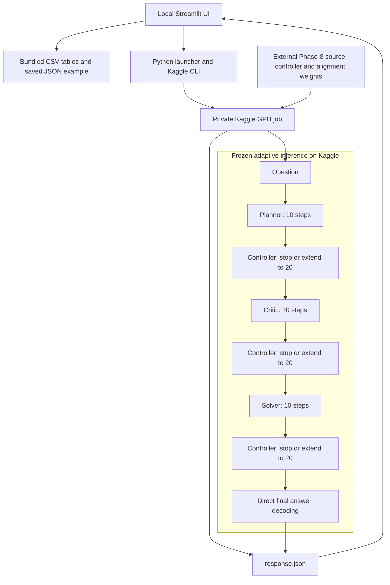

# Adaptive Latent Communication for Efficient Multi-Agent LLM Reasoning

**Want to run the project?** Follow the [step-by-step run guide](RUN_README.md)
for setup, launch commands, and troubleshooting.

M.Tech Final-Year Project · Research Dashboard and Remote Inference Interface

A Streamlit application for presenting and exploring a completed adaptive multi-agent reasoning experiment. The system uses **Planner → Critic → Solver** agents with a learned controller that selects either 10 or 20 latent reasoning steps for each agent.

The dashboard runs locally from preserved research outputs. Optional fresh inference runs on a private Kaggle GPU job using the frozen research backend.

> **Project scope:** This repository contains the presentation UI, compact experimental evidence, a reference notebook, and remote inference orchestration. The full research backend, trained controller, and latent alignment weights are external Phase-8 artifacts required for fresh GPU inference.

## Contents

- [Adaptive Latent Communication for Efficient Multi-Agent LLM Reasoning](#adaptive-latent-communication-for-efficient-multi-agent-llm-reasoning)
  - [Contents](#contents)
  - [Research objective](#research-objective)
  - [Application features](#application-features)
  - [Architecture and method](#architecture-and-method)
  - [Experimental results](#experimental-results)
  - [Quick start](#quick-start)
    - [Windows PowerShell](#windows-powershell)
    - [Linux or macOS](#linux-or-macos)
    - [Local technology stack](#local-technology-stack)
  - [Optional Kaggle inference](#optional-kaggle-inference)
    - [Prerequisites and configuration](#prerequisites-and-configuration)
    - [Saved demonstration](#saved-demonstration)
    - [Fresh remote job](#fresh-remote-job)
  - [Repository structure](#repository-structure)
  - [Data provenance and reproducibility](#data-provenance-and-reproducibility)
  - [Validation](#validation)
  - [Final-year demonstration](#final-year-demonstration)
  - [Troubleshooting](#troubleshooting)
  - [Limitations and future work](#limitations-and-future-work)

## Research objective

Fixed reasoning budgets allocate the same amount of computation to every agent and problem. This project investigates whether a learned stopping policy can improve the accuracy–computation trade-off by assigning additional latent reasoning only when its predicted utility is positive.

The completed experiment compares:

| Policy | Per-agent allocation | Total latent steps per question |
| --- | --- | ---: |
| Fixed-10 | 10 steps for every agent | 30 |
| Fixed-20 | 20 steps for every agent | 60 |
| Adaptive | Stop at 10 or continue to 20 for each agent | 30, 40, 50, or 60 |

The evaluation covers **512 problems: 256 GSM8K and 256 ARC-Challenge**.

## Application features

| Page | Purpose |
| --- | --- |
| Research Dashboard | Compare accuracy, latent computation, and measured latency across policies. |
| Live Kaggle Inference | Inspect a saved fidelity example or submit a fresh remote GPU request. |
| Benchmark Explorer | Filter recovered per-question records and inspect agent decisions. |
| Controller Analysis | Compare continuation rates, predicted utility, and compute allocation. |
| Statistical Evidence | Inspect paired comparisons, bootstrap intervals, and exact McNemar tests. |
| Architecture | Explain latent reasoning, working-memory transfer, and learned stopping. |
| Reproducibility | Inspect the frozen configuration and historical evaluation protocol. |
| Kaggle Connection | Check local CLI availability and authentication. |

The interface includes a custom research-console stylesheet, charts, agent allocation cards, and background monitoring for fresh jobs. Streamlit widget defaults are configured in `.streamlit/config.toml`; presentation styles live in `ui/assets/styles.css`. Results pages and the saved example need neither a local GPU nor Kaggle credentials.

## Architecture and method



All three roles share the frozen **Qwen/Qwen3-4B** backbone. Hidden states are realigned into the model's input space for subsequent latent steps, and the key/value cache carries working memory between roles. Planner and Critic do not generate intermediate natural-language messages.

At each agent's 10-step checkpoint, a **Gradient Boosting Huber** controller estimates the marginal utility of continuing. Its inputs include temporal representation-distance, entropy, hidden-norm signals, and agent role. The frozen threshold is **0.0**:

```text
predicted marginal utility > 0  → CONTINUE from the existing state to 20 steps
predicted marginal utility ≤ 0  → STOP at 10 steps
```

The training target is the change in negative log-likelihood between the two budgets, `ΔU = NLL₁₀ − NLL₂₀`. At inference, the controller uses observed signals; an optional reference answer is used afterward to score the prediction.

## Experimental results

These values come from the bundled Phase-9 summary tables.

| System | Correct / 512 | Combined accuracy | Mean latent steps | Mean model wall latency |
| -------------- | ----------: | --------: | --------: | ------: |
| Fixed-10 | 317 | 61.91% | 30.00 | 9.54 s |
| Fixed-20 | 288 | 56.25% | 60.00 | 10.54 s |
| Adaptive | 320 | **62.50%** | 49.04 | 10.31 s |

**Adaptive versus Fixed-20:** accuracy increases by **6.25 percentage points**, with a paired 95% bootstrap interval of **+2.15 to +10.55 points** and exact McNemar **p = 0.004455**. Mean latent-step use decreases by **18.26%**.

| Dataset | Fixed-10 accuracy | Fixed-20 accuracy | Adaptive accuracy |
| --- | ---: | ---: | ---: |
| GSM8K | **60.16%** | 42.58% | 54.30% |
| ARC-Challenge | 63.67% | 69.92% | **70.70%** |

**Interpretation:** Adaptive improves the combined result relative to Fixed-20. It does not significantly outperform Fixed-10 overall (`p = 0.871618`), and Fixed-10 uses fewer steps and less time. On GSM8K, Fixed-10 has the highest accuracy. The evidence supports a dataset-dependent reasoning budget, rather than a universal benefit from deeper reasoning.

Latent-step savings are not equivalent to wall-clock savings. Reported model timings exclude Kaggle queueing, runtime provisioning, and model loading.

## Quick start

Use **Python 3.11**, matching the repository's CI configuration. Run commands from the project root.

### Windows PowerShell

```powershell
# Allow the provided scripts for this PowerShell session.
Set-ExecutionPolicy -Scope Process Bypass

# Create .venv and install dependencies.
.\scripts\bootstrap_windows.ps1

# Start the application.
.\scripts\run_ui.ps1
```

If the environment is already installed, only the final command is needed.

### Linux or macOS

```bash
python3.11 -m venv .venv
source .venv/bin/activate
python -m pip install -r requirements.txt
python -m streamlit run ui/app.py
```

Open **<http://localhost:8501>**, or the address printed by Streamlit.

### Local technology stack

| Component | Role |
| --- | --- |
| Streamlit | Application layout, navigation, forms, and job status |
| pandas / NumPy | Research table loading and analysis |
| Plotly | Interactive comparison and distribution charts |
| Kaggle CLI | Remote job submission, status, and output retrieval |
| pytest / GitHub Actions | Local checks and continuous integration |

Dependency ranges are maintained in [requirements.txt](requirements.txt). The local dependency file does not install the full GPU research stack. The remote template expects PyTorch, Transformers, and the research backend's dependencies in the Kaggle environment, then restores the Phase-8 project.

## Optional Kaggle inference

### Prerequisites and configuration

Fresh inference requires an authenticated Kaggle account, GPU availability, internet access in the remote job, and permission to access the Phase-8 dataset.

The current configuration targets:

| Setting | Value / location |
| --- | --- |
| Private inference kernel | `malkee/adaptive-latent-mas-live-inference` |
| Phase-8 dataset | `malkee/adaptive-latent-mas-phase8-complete` |
| Kernel and dataset metadata | `kaggle_job/live_inference/kernel-metadata.json` |
| Launcher kernel reference | `KERNEL_REF` in `scripts/kaggle_remote_infer.py` |
| Model revision | `1cfa9a7208912126459214e8b04321603b3df60c` |
| Controller threshold | `0.0` |
| Maximum decoded tokens | `160` |

For another account, update both the metadata kernel ID and the launcher's `KERNEL_REF`; configure an accessible Phase-8 dataset containing the required research artifacts. Account-specific metadata assertions in the tests must then be updated as well.

Use your configured Kaggle authentication, such as `KAGGLE_API_TOKEN` in the shell environment or a legacy credentials file at `%USERPROFILE%\.kaggle\kaggle.json`. `.env.example` is a placeholder reference; the application does **not** automatically load `.env` files.

Check the connection:

```powershell
.\.venv\Scripts\python.exe scripts\kaggle_check.py
```

Successful authentication ends with `KAGGLE_CONNECTION_OK`.

### Saved demonstration

Open **Live Kaggle Inference → Verified demo — instant**. This loads [data/verified_live_example.json](data/verified_live_example.json), a recorded fidelity run for `gsm8k_test_00198`:

| Prediction     | Planner  | Critic   | Solver   | Total    |
| -------------- | -------- | -------- | -------- | -------- |
| 320, correct   | 20 steps | 20 steps | 10 steps | 50 steps |

This is saved evidence. It does not submit a new job. Its recorded model pipeline latency is approximately **12.95 seconds**.

### Fresh remote job

Use **Live Kaggle Inference → Fresh Kaggle run**, or submit a question from PowerShell:

```powershell
.\.venv\Scripts\python.exe scripts\kaggle_remote_infer.py `
  --dataset gsm8k `
  --question "A shop sells a notebook for 40. Rahul buys 3 and pays 200. How much change?" `
  --reference "80"
```

To rerun the approved Phase-9 fidelity example:

```powershell
.\.venv\Scripts\python.exe scripts\kaggle_remote_infer.py `
  --dataset gsm8k `
  --benchmark-example-id gsm8k_test_00198 `
  --id phase9_fidelity_00198
```

The CLI accepts `gsm8k` and `arc_challenge`; the current UI submits GSM8K-style questions. Do not supply `--reference` with `--benchmark-example-id`. The remote template permits only the approved GSM8K verification ID and blocks other benchmark IDs to protect the sealed remainder.

The launcher generates request-specific code under `.kaggle_runtime/`, pushes a private job, polls every 20 seconds by default, and downloads only `response.json` under `artifacts/live_inference/`. The default timeout is 40 minutes; CLI options `--poll-seconds` and `--timeout-minutes` control these settings. The UI checks its background process every three seconds.

Kaggle is a batch compute service: a fresh request can take several minutes before inference starts. Use one fresh job at a time across UI sessions and CLI processes, since they share a kernel and local output paths.

For general output retrieval, activate the virtual environment and run:

```powershell
.\.venv\Scripts\Activate.ps1
python scripts\sync_kaggle_outputs.py `
  --kernel malkee/adaptive-latent-mas-live-inference `
  --pattern '.*response\.json$'
```

This separate utility downloads to `artifacts/kaggle/` by default. It does not replace the curated benchmark data.

## Repository structure

```text
Adaptive_Latent_MAS/
├── .github/workflows/             # CI
├── .streamlit/config.toml         # Presentation theme
├── data/
│   ├── phase9_recovered_console_records.csv
│   ├── phase9_final_performance_summary.csv
│   ├── phase9_controller_decisions.csv
│   ├── phase9_paired_statistical_comparison.csv
│   └── verified_live_example.json
├── kaggle_job/live_inference/
│   ├── kernel-metadata.json       # Private GPU job configuration
│   └── remote_inference.py.template
├── notebooks/
│   └── phase9_completed_reference.ipynb
├── scripts/
│   ├── bootstrap_windows.ps1
│   ├── run_ui.ps1
│   ├── kaggle_check.py
│   ├── kaggle_remote_infer.py
│   └── sync_kaggle_outputs.py
├── tests/                        # UI, data, and remote configuration checks
├── ui/
│   ├── app.py
│   ├── assets/styles.css           # Presentation styles
│   └── services/kaggle_live.py
├── .env.example                  # Credential placeholders only
├── .gitignore
├── README.md                     # Consolidated project documentation
├── RUN_README.md                 # Setup and launch guide
├── pyproject.toml                # Ruff and pytest configuration
├── requirements-dev.txt          # Runtime dependencies plus Ruff
├── requirements.txt
└── VERSION
```

Python package marker files are omitted from the diagram. `.venv/`, caches, `.kaggle_runtime/`, and `artifacts/` are local or generated directories excluded from version control. Keep source, tests, compact evidence, and the reference notebook in the submission; exclude credentials, patch ZIPs, virtual environments, and downloaded model weights.

## Data provenance and reproducibility

| Artifact | Evidence retained |
| --- | --- |
| `phase9_recovered_console_records.csv` | 512 recovered per-question results, decisions, utilities, and computation metrics |
| `phase9_final_performance_summary.csv` | Per-dataset and combined accuracy, Wilson intervals, steps, latency, and GPU memory |
| `phase9_controller_decisions.csv` | Per-role continuation rates and mean selected steps |
| `phase9_paired_statistical_comparison.csv` | Paired accuracy differences, bootstrap intervals, and McNemar tests |
| `verified_live_example.json` | Saved remote fidelity response, model identity, controller hash, and agent allocation |
| `phase9_completed_reference.ipynb` | Completed benchmark code and preserved console output |

The historical evaluation reports a frozen controller and threshold, no test-set retraining or threshold tuning, true continuation from 10 to 20 steps, and a sealed remainder of **1,063 GSM8K + 916 ARC-Challenge** examples.

Recovered console records contain shortened question previews. Missing full questions and reference answers are not reconstructed by the UI. Reproducing the complete benchmark requires the external research project and artifacts; bundled tables alone are sufficient to reproduce the dashboard.

The remote template checks the controller hash against the Phase-8 manifest and pins the model revision. Dependency version ranges are not an exact environment lock, so these controls do not guarantee bit-for-bit reproducibility across all future environments.

Never commit API tokens, `kaggle.json`, `.env` secrets, Streamlit secrets, or private model artifacts. Relevant paths are excluded by `.gitignore`.

## Validation

```powershell
.\.venv\Scripts\python.exe -m pytest -q
```

On an activated Linux/macOS environment, use `python -m pytest -q`.

The local suite covers benchmark counts and headline values, controller decision fields, saved example consistency, all eight UI pages, the running-job monitor, theme configuration, private GPU metadata, and remote launcher safeguards. Download regression checks simulate Kaggle output and verify that active logs and previous results survive failed downloads.

For development, install the lint tool and run the same checks as CI:

```powershell
.\.venv\Scripts\python.exe -m pip install -r requirements-dev.txt
.\.venv\Scripts\python.exe -m ruff check .
.\.venv\Scripts\python.exe -m ruff format --check .
.\.venv\Scripts\python.exe -m pytest -q
```

GitHub Actions runs lint, formatting, and tests on Python 3.11. To apply formatting locally, run `python -m ruff format .` using the project environment. Preserved research notebooks and generated artifacts are excluded from formatting.

The **72/72 regression tests** shown in the historical benchmark evidence belong to the external research backend. They are separate from this repository's local checks. Local checks do not launch a GPU job or independently reproduce benchmark accuracy.

## Final-year demonstration

1. **Research Dashboard:** Introduce the fixed-budget problem and show the accuracy–computation comparison. Explain the Fixed-10 qualification.
2. **Benchmark Explorer:** Select a recorded case and explain each agent's STOP/CONTINUE allocation.
3. **Controller Analysis:** Compare continuation rates across roles and datasets.
4. **Statistical Evidence:** Explain the paired bootstrap interval and McNemar result against Fixed-20.
5. **Architecture and Reproducibility:** Describe latent state transfer, frozen configuration, and evidence provenance.
6. **Live Kaggle Inference:** Show the saved fidelity example immediately. Use a fresh run when credentials, GPU availability, and presentation time permit.

## Troubleshooting

| Symptom | Action |
| --- | --- |
| Python or `.venv` is missing | Install Python 3.11 and run the bootstrap script from the project root. |
| PowerShell blocks scripts | Apply the process-scoped execution policy in the quick start, or invoke `.venv\Scripts\python.exe -m streamlit run ui/app.py` directly. |
| Import or dependency error | Use the virtual environment's Python and install `requirements.txt` into that environment. |
| Port 8501 is occupied | Start with `python -m streamlit run ui/app.py --server.port 8502`. |
| Data file is missing | Restore the bundled `data/` files; the dashboard requires all four CSV tables. |
| Kaggle authentication fails | Verify credentials in the launching shell, then rerun `scripts/kaggle_check.py`. |
| Remote job fails before producing JSON | Inspect Kaggle logs, dataset permissions, Phase-8 artifacts, and GPU availability. |
| Fresh inference appears slow | Allow for queueing and model loading; use the saved example for an immediate demonstration. |
| Remote inference times out | Inspect the job on Kaggle; a local timeout does not cancel the remote job. |

## Limitations and future work

- The completed policy selects only 10 or 20 steps per agent. Progressive **5 → 10 → 15 → 20** halting is proposed future work.
- The experiment uses one shared model family. Heterogeneous cross-model latent alignment remains a future extension.
- Fresh inference uses a shared batch kernel and shared local files; it is intended for a single-user research demonstration.
- Batch inference could amortize model-loading cost across several questions; it is not implemented here.
- The 512-example evaluation and one saved fidelity run do not establish generalization to all tasks or models.
